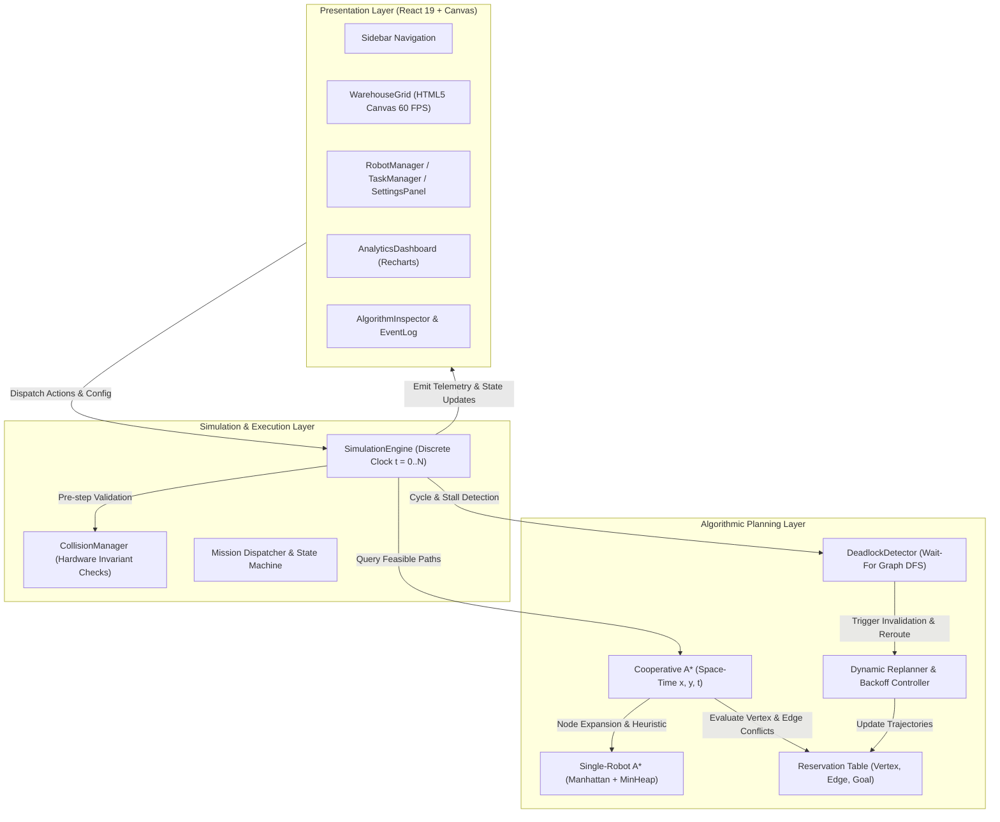
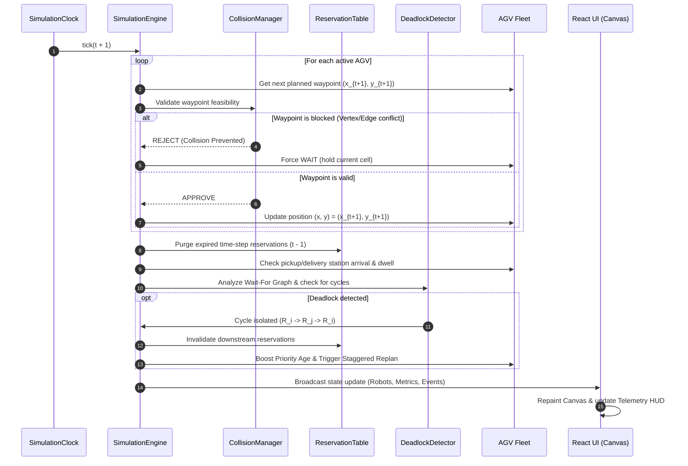

# Project Architecture & System Design

**Autonomous Warehouse Robot Path Planning & Collision Avoidance Simulator**  
*College Project Technical Architecture Documentation*

---

## 1. Architectural Overview

The Autonomous Warehouse Robot Simulator is engineered as a deterministic, modular, high-frequency discrete-time multi-agent simulation system. The architecture cleanly decouples the mathematical planning algorithms, the physics and reservation engine, and the reactive user interface.

---

## 2. Layer Descriptions

### 2.1 Algorithmic Planning Layer (`src/algorithms/`)

The planning layer contains deterministic algorithms for single-agent and multi-agent space-time routing:

1. **`astar.ts` — Single-Agent $A^*$ Planner:**
   - Implements baseline $A^*$ using an admissible Manhattan distance heuristic:
     $$h(n) = |x_n - x_G| + |y_n - y_G|$$
   - Uses an optimized binary `MinHeap` priority queue for $O(\log N)$ node insertion and retrieval.
   - Enforces 4-connected grid transitions $(\Delta x, \Delta y) \in \{(0, -1), (1, 0), (0, 1), (-1, 0)\}$.
   - Includes a tie-breaking epsilon ($1.001$) favoring nodes closer to the destination to minimize superfluous expansions.

2. **`cooperativeAstar.ts` — Multi-Agent Space-Time $CA^*$ Planner:**
   - Extends state representation into discrete space-time $s = (x, y, t)$.
   - Evaluates 5 discrete transitions per step: North, South, East, West, and an in-place **Wait Action** $(x, y, t+1)$.
   - Sequences robot path reservations based on effective priority.
   - Enforces a safety cutoff limit (default: 8,000 node expansions) to prevent thread exhaustion during severe corridor congestion.

3. **`reservationTable.ts` — Spatio-Temporal Reservation System:**
   - **Vertex Reservation Map:** Stores locks for tuples $(x, y, t) \mapsto \text{robotId}$.
   - **Edge Reservation Map:** Stores directed transitions $(u, v, t) \mapsto \text{robotId}$ to strictly prevent head-on traversals $(v \to u, t)$.
   - **Permanent Goal Reservation Map:** Stores indefinite occupancy $(x_G, y_G, t \ge t_{arr}) \mapsto \text{robotId}$ preventing trailing robots from pathing through stationary parked AGVs.

4. **`deadlockDetector.ts` — Dependency Cycle & Stall Detection:**
   - Builds a directed *Wait-For Graph* $G_W = (V, E)$, where a directed edge $R_i \to R_j$ denotes that AGV $R_i$ is obstructed by the space-time claim or physical presence of AGV $R_j$.
   - Executes recursive Depth-First Search (DFS) with a visited call stack to isolate genuine circular waiting topologies ($R_1 \to R_2 \to \dots \to R_k \to R_1$).
   - Distinguishes **Genuine Deadlock Cycles** from **Transient Stall Alerts** and **Deferred Recovery Invocations**.

5. **`replanner.ts` — In-Flight Trajectory Replanner & Recovery:**
   - Detects dynamic obstacle drops intersecting with future planned steps $[(x_{t}, y_{t}), \dots]$.
   - Safely invalidates forward reservations in the reservation table while keeping past steps intact.
   - Computes local detours for obstructed vehicles while unaffected AGVs continue along undisturbed paths.
   - Implements exponential replanning backoff to eliminate CPU thrashing during persistent bottleneck waits.

---

### 2.2 Simulation & Execution Layer (`src/simulation/`)

The simulation layer controls time progression, validates kinematic physics, and guarantees safety invariants:

1. **`simulationEngine.ts` — Central Deterministic Orchestrator:**
   - Maintains the master simulation state: grid map, robot fleet, task queues, and global metrics.
   - Executes synchronous discrete clock ticks $t \to t+1$.
   - Coordinates the step lifecycle:
     1. Tick increment and clock synchronization.
     2. Pre-movement collision validation.
     3. AGV physical coordinate translation.
     4. Task pickup / dropoff status updates.
     5. Deadlock detection and stall telemetry updates.
     6. State dispatch to UI listeners.

2. **`simulationClock.ts` — Discrete Clock Controller:**
   - Provides deterministic integer tick management ($0, 1, 2, \dots$).
   - Supports variable playback rates ($1\times$ to $10\times$ speed multipliers) via non-blocking JavaScript timers.
   - Supports single-step forward execution (`stepForward()`) for cycle-by-cycle academic verification.

3. **`collisionManager.ts` — Hardware Safety & Invariant Verification:**
   - Operates as a redundant, fail-safe verification layer independent of path planning.
   - Intercepts all proposed coordinate updates before physical application.
   - Formally rejects:
     - **Vertex Conflicts:** Two AGVs occupying cell $(x, y)$ at the same tick $t$.
     - **Edge Swaps:** AGV $A$ moving $u \to v$ while AGV $B$ moves $v \to u$ at $t$.
     - **Static Obstacle Collisions:** AGVs entering shelves, boundary walls, or dynamic obstacles.
   - Increments the `collisionsPrevented` telemetry metric when an invalid move is rejected and commands the robot to hold position.

---

### 2.3 Presentation Layer (`src/components/`)

The UI is built with React 19, TypeScript, and HTML5 Canvas:

1. **`WarehouseGrid.tsx`:**
   - High-performance 60 FPS HTML5 Canvas renderer.
   - Renders grid cells, shelving units, charging docks, pickup/delivery stations, and passing bays.
   - Displays animated AGVs with status rings (Idle, Moving, Waiting, Charging, Error, Yielding), orientation arrows, and cargo payloads.
   - Provides debug overlays: path trails, reservation ghosts, search exploration heatmaps, and coordinate indices.

2. **`SidebarNav.tsx`:**
   - Engineering navigation bar allowing instant switching between all 8 core modules:
     1. Overview
     2. Warehouse Layout
     3. Robot Fleet
     4. Task Dispatcher
     5. Path Planning
     6. Collision Avoidance
     7. Performance Analysis
     8. Settings

3. **`RobotManager.tsx`:**
   - Fleet control roster listing all AGVs (`AGV-01` through `AGV-10`).
   - Displays real-time battery State of Charge (SOC), current coordinates, assigned mission ID, base priority, and priority age.
   - Supports commissioning/decommissioning AGVs to evaluate fleet scaling from 1 to 10 vehicles.

4. **`TaskManager.tsx`:**
   - Dispatch interface for inbound (storage) and outbound (retrieval) transport orders.
   - Manages station queues, source-destination bindings, and task lifecycle tracking (Pending $\to$ In Progress $\to$ Completed).

5. **`AlgorithmInspector.tsx` & `EventLog.tsx`:**
   - Displays real-time reservation table entries across time steps $t, t+1, \dots, t+K$.
   - Stream of filterable simulation telemetry events (Task Dispatched, Path Computed, Obstacle Detected, Replanning Triggered, Conflict Prevented).

6. **`AnalyticsDashboard.tsx`:**
   - Interactive charts powered by Recharts: planning time distribution, node expansions, fleet waiting ticks, and delivery throughput across fleet configurations.

---

## 3. Data Flow & Simulation Lifecycle

The following sequence details what occurs during a single discrete simulation tick:

---

## 4. State Management & Determinism

To guarantee reproducible benchmarking and academic consistency:
- **No Non-Deterministic Math:** Randomization is seeded via reproducible pseudo-random number generators (PRNG) when synthesizing benchmark workloads.
- **Synchronous Discrete Time:** Time advances in discrete integer units ($t \in \mathbb{N}$). Physical distance is quantized to grid units ($1\text{ cell} = 1\text{ distance unit}$).
- **State Immutability:** Engine updates are broadcast via decoupled callback hooks, preventing race conditions between the canvas animation frame loop and simulation state transitions.
